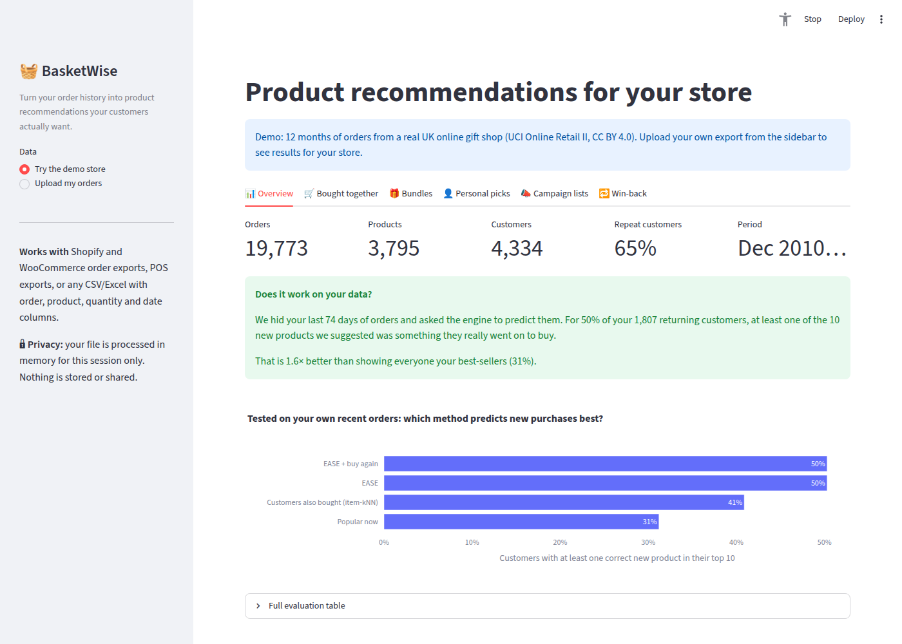
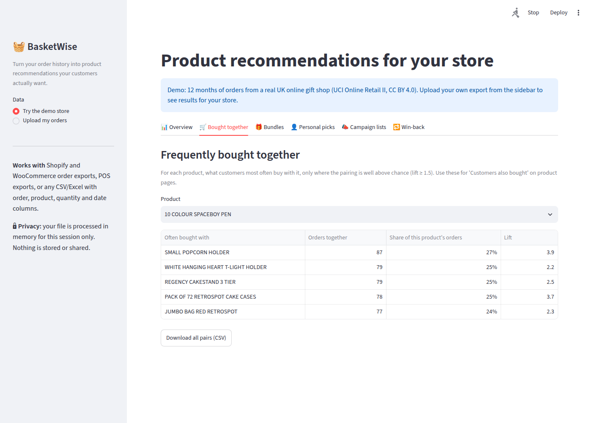
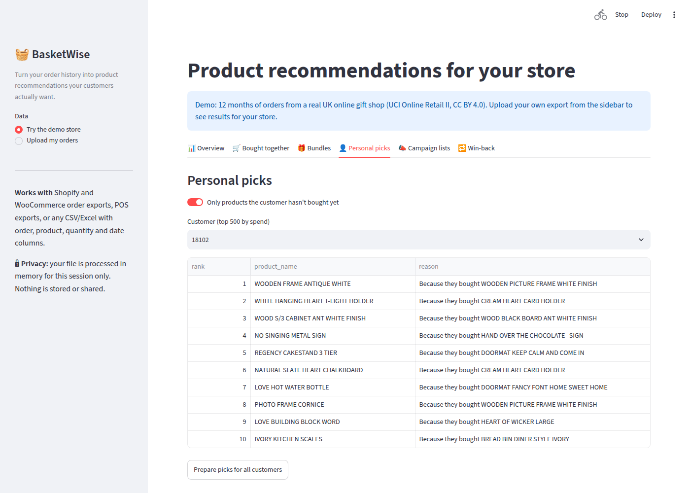

# 🧺 BasketWise: Product Recommendations for Online Stores

**Upload your order export and get the recommendations you can act on: "frequently bought together", bundles, personal picks, campaign lists and a win-back list. The engine is tested on your own sales history before you trust it.**




## Who it's for
Small and mid-sized online stores (Shopify, WooCommerce, POS) that have order history but no data team. Big platforms have recommendation engines; most small stores don't. BasketWise turns a CSV export into:

| Output | Use it for |
|---|---|
| 🛒 **Frequently bought together** | "Customers also bought" on product pages |
| 🎁 **Bundle ideas** | Discounted pairs that customers already buy together |
| 👤 **Personal picks** (with a reason for each) | Personalised emails or WhatsApp messages: "because you bought X…" |
| 📣 **Campaign lists** | Who to target for a product launch or clearance |
| 🔁 **Win-back list** | Valuable customers who stopped buying, each with three likely products |

## Does it work? Results on a real store
Tested on **UCI Online Retail II** (about 1 million order lines from a UK online gift shop, 2009–2011). Every model learned from orders before **10 September 2011** and was scored on what **2,286 returning customers actually bought** in the following 90 days. Hyper-parameters were chosen on an **earlier validation window**, so the test period stayed untouched.

| Method | Hit rate@10 (any product) | NDCG@10 | **Hit rate@10 (new products only)** | Catalogue coverage |
|---|---|---|---|---|
| Popular now (best-sellers) | 48.8% | 0.101 | 30.2% | 0.2% |
| Buy again (own history) | 78.8% | 0.329 | – | 61.9% |
| Item-to-item collaborative filtering | 62.6% | 0.184 | 35.9% | 19.0% |
| **EASE** (Steck, 2019) | 75.1% | 0.305 | **45.9%** | 26.3% |
| **EASE + buy again (hybrid)** | **79.3%** | **0.350** | **45.9%** | 41.8% |

- **New products:** 46% of customers had at least one correct *new* product in their top 10, **1.5× better than recommending best-sellers**. Ranking quality (NDCG) is 78% higher.
- **Everything (including re-orders):** the hybrid beats the strong "buy again" baseline on every metric, while recommending from a far larger share of the catalogue.
- **On any uploaded store,** the app repeats this test on that store's own history, picks the best method automatically and explains the result in plain language.

<p>


</p>

## How it works

```
order export (CSV / Excel) ─▶ importer: detects Shopify / WooCommerce / generic columns,
                              fills order-level fields down, detects day-first dates, normalises IDs
        │
        ▼
cleaning: cancellations & returns, shipping / fee / voucher lines, zero-price lines,
          every removal counted and shown to the owner
        │
        ├─▶ order-level co-purchase (guests included) ─▶ frequently bought together, bundles
        │
        ▼
customer × product matrix (log of order counts, SciPy sparse)
        │
        ▼
temporal hold-out on the store's own data ─▶ popularity · buy again · item-kNN · EASE · hybrid
        │                                     (hit rate, precision, recall, NDCG @10, coverage)
        ▼
best model per mode, refit on all data ─▶ personal picks with reasons · campaign lists · win-back
```

**Design decisions**
- **Implicit feedback:** purchases, not ratings. Weights are `log(1 + orders)`, so a customer's 30th re-order of napkins doesn't drown out everything else.
- **Two evaluation modes:** retail customers re-order constantly, so "buy again" is a strong baseline. "Discovery" mode (new products only) measures the value store owners actually pay for.
- **EASE:** a closed-form item-item model (one matrix inversion) that is fast on a CPU and competitive with much more complex methods in the research literature.
- **Explanations:** each pick names the past purchase that contributed most to it, or says it's a re-order.
- **Product-page pairs are ranked by confidence, filtered by lift ≥ 1.5:** ranking by lift alone surfaced rare oddities bought together in only 1% of orders.
- **Data-quality lessons:** a naive "carriage" rule deleted real products ("FRENCH CARRIAGE LANTERN"); ambiguous words now only match at the start of a line name, and a test guards it. Mixed-case SKUs (`85049g` / `85049G`) are merged, and Excel's `12448.0` customer IDs are normalised.

## Privacy
Uploaded files are processed in memory for the session only, and nothing is written to disk or sent anywhere. Customer IDs (emails or phones) appear only in the owner's own downloads.

## Run it

```bash
uv sync
uv run streamlit run app/streamlit_app.py     # opens the demo store; upload your own export from the sidebar
uv run pytest                                 # 17 tests
```

## Project structure
```
src/basketwise/
├── importer.py     # Shopify / WooCommerce / generic column detection, day-first dates, ID normalisation
├── cleaning.py     # non-product, cancellation and zero-price rules with a removal report
├── models.py       # popularity, buy again, item-kNN, EASE, hybrid; sparse matrices
├── evaluation.py   # temporal split, hit rate / precision / recall / NDCG@k, two modes
├── outputs.py      # bought together, bundles, personal picks with reasons, campaign and win-back lists
└── engine.py       # end-to-end run on one store with automatic model selection
app/streamlit_app.py
data/demo_store.parquet   # 12-month demo store (UCI Online Retail II, CC BY 4.0)
tests/
```

## Limitations
- It needs order history with repeat customers. Personal picks need at least 50 identified customers, and below that the app says so instead of over-promising (bought-together and bundles still work).
- Offline accuracy is not the same as revenue uplift; an A/B test in the store is the real proof.
- It doesn't yet use product attributes (category, price) or cover brand-new products with no sales (the cold-start problem).

## Data and credits
Demo data: [Online Retail II](https://archive.ics.uci.edu/dataset/502/online+retail+ii) by Daqing Chen, UCI Machine Learning Repository, CC BY 4.0. EASE: H. Steck, *Embarrassingly Shallow Autoencoders for Sparse Data*, WWW 2019.

Code: MIT licence. Built by **[Anas Khan](https://www.linkedin.com/in/anas-khan-ds/)**, Data Science student at IMSciences Peshawar. Available for custom setups on [Fiverr](https://www.fiverr.com/sellers/anasxm2/).
